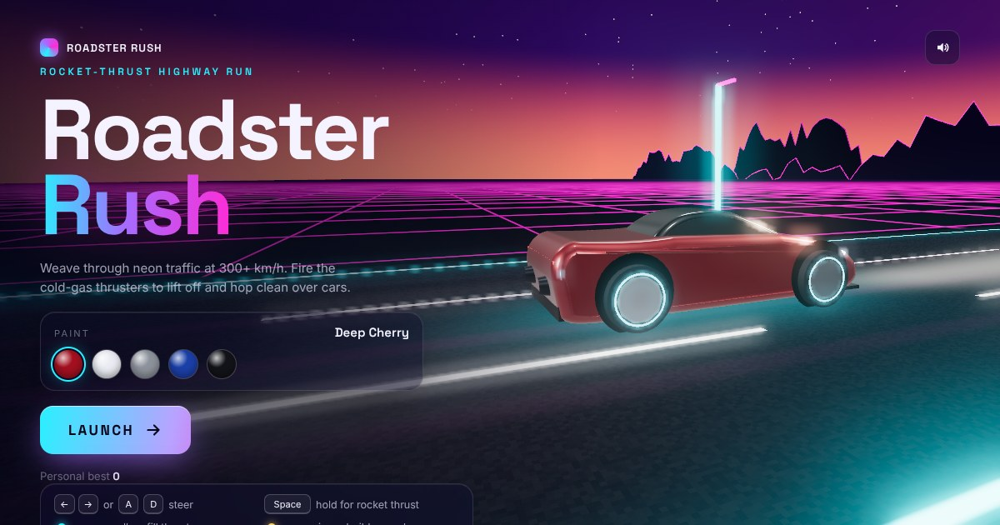

# Roadster Rush

A 3D rocket-thrust highway run in the browser, inspired by the Tesla Roadster. Weave through neon traffic, hold thrust to lift off and hop clean over cars, chain near misses into combos and push through four zones.

**Play:** https://asadravian.github.io/Tesla-Roadster-Game/



## Controls

| Action | Keyboard | Touch | Gamepad |
| --- | --- | --- | --- |
| Steer | ← → or A D | ◀ ▶ buttons | Left stick / D-pad |
| Rocket thrust (hold) | Space, W, ↑ or Shift | Thrust button | A / RT |
| Pause | P or Esc | Pause button | |
| Mute | M | Sound button | |

Tips: thrust doubles your score and lifts you over traffic, but it drains energy. Grab cyan energy cells to refill. Tap thrust the moment the lights say GO for a perfect launch.

## Features

- Real-time 3D with Three.js: a procedurally modelled roadster with clearcoat paint, HDR bloom, a synthwave sky, a scrolling neon grid and speed streaks
- Rocket thrusters with shader flames, hover physics and a chase camera that widens its field of view with speed
- Four zones (Sunset Boulevard, Neon Canyon, Red Planet, Orbit Run) that blend their colour palettes as you drive
- Garage with five paint finishes, km/h or mph speedometer, saved best score
- Synthesised sound: electric motor whine, wind, thrust roar and a small synthwave soundtrack, all made with the Web Audio API (no audio files)
- Works on desktop and phones, supports gamepads, and lowers resolution automatically on slower devices
- No build step and no external runtime requests apart from Google Fonts: Three.js is vendored in `vendor/`

## Run locally

Any static server works:

```bash
python3 -m http.server 8000
# open http://localhost:8000
```

## Deploy on GitHub Pages

1. Settings → Pages
2. Source: **Deploy from a branch**, branch `main` (or the branch holding this code), folder `/ (root)`
3. Save. The game appears at `https://<user>.github.io/Tesla-Roadster-Game/` within a minute or two.

## Project layout

```
index.html      page, HUD and menus
style.css       UI styling (glass panels, HUD, responsive layout)
js/main.js      game loop, input, obstacles, scoring, camera, post-processing
js/car.js       the roadster model and thruster flames
js/world.js     sky, road, grid, mountains, roadside props, zone palettes
js/audio.js     procedural sound and music
vendor/three/   Three.js r170 (MIT licence)
```

## Credits

Designed and built with [Claude Code](https://claude.com/claude-code).

Independent fan project inspired by the Tesla Roadster. Not affiliated with or endorsed by Tesla, Inc. No logos or trademarks are used in the game.
